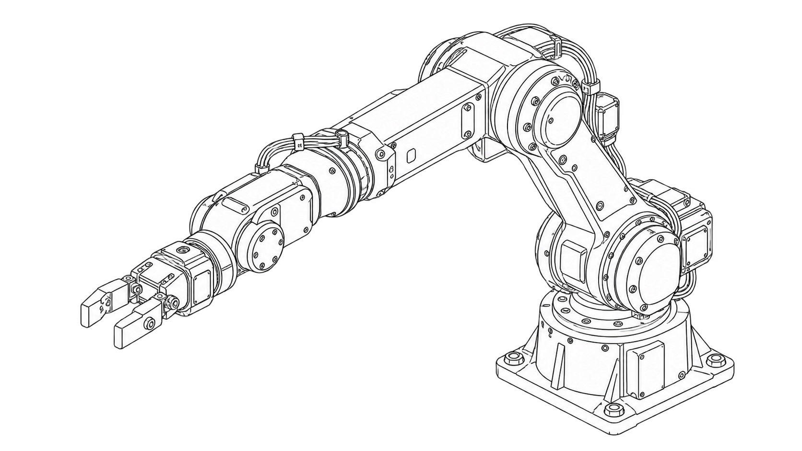
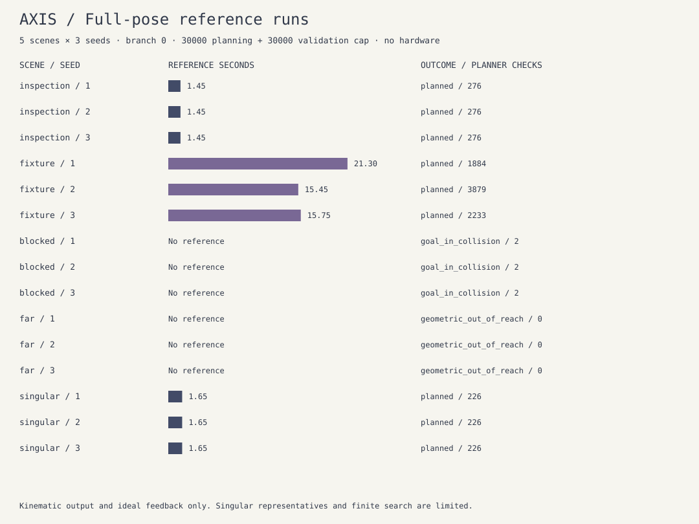

# Six-axis Robotic Arm



*User-approved generated line-art concept. This is not evidence of an assembled arm.*

**Axis** is an offline full-pose robot laboratory. Set a tool position and orientation, inspect the supported inverse-kinematics solutions, choose a branch, and replay a checked six-joint reference. A host control emulator exercises arm/start/stop, feedback and watchdog states without connecting to a device.

The model is an ideal six-revolute-joint arm with a co-located spherical wrist. It is not a measured commercial robot, a physical build or a payload-rated mechanism. Mechanical design, motors, electronics, firmware and physical tests remain pending.

## Run locally

Use Node.js 22 or 24. No runtime/development packages, paid keys, external fonts, CDN assets or analytics are required.

```sh
npm ci --ignore-scripts
npm run check
npm start
```

Open <http://127.0.0.1:8802/>. Choose a scene and select **Solve & plan**. The lab shows target/current tool axes, IK branches, the six-joint table, TCP position, tool rotation and RPY angles. Orbit the projection, play/step/scrub the actual reference, or export its JSON. Scene, target, branch, seed and budget edits cancel in-flight work and clear the old evidence. A failed run enables no replay.

Custom position uses metres; orientation uses degrees at the UI boundary and the matrix convention `Rz(yaw) Ry(pitch) Rx(roll)`. Internal joint angles are radians. Presets retain their exact matrix values until the user edits the displayed target. The included server binds only loopback and serves a fixed public file list with GET/HEAD, Host validation and CSP. `npm run build` creates a portable `dist/` static site for an origin-root static server. Computation runs locally in a browser worker; no result is persisted automatically.

## Model and methods

The axes are Z, -Y, -Y, X, -Y, X in successive local frames. Shoulder height is 0.15 m; upper/fore/tool lengths are 0.30/0.25/0.10 m. The final three wrist axes share a centre. Tool roll changes orientation without moving an axial tool centreline; this is a declared geometric simplification.

- Forward kinematics composes rigid transforms and returns position, rotation, joint origins and world axes. The geometric Jacobian is tested against independent position/orientation finite differences.
- Analytic IK separates wrist-centre position and wrist orientation. It checks signed radial/yaw, elbow and both nonsingular X-Y-X wrist branches, joint limits and independent FK residuals. Aligned-wrist cases return supported representatives of a coupled roll family. Base-axis singularities use a limited yaw representative set; the solver does not claim exhaustive constrained singular IK.
- Routes try direct and raised stages, then a seeded bounded bidirectional RRT. Conservative capsules/spheres check obstacles, floor/base and nonadjacent self collision. A Lipschitz displacement bound with midpoint inflation covers the **whole** joint interpolation, including wrist/tool motion, rather than endpoints alone.
- Quintic timing gives zero endpoint velocity/acceleration, no more than 1 rad/s joint speed and 2 rad/s² acceleration. These are kinematic references, not torque control or measured tracking.
- The host reference runner independently validates its loaded path, then requires explicit arm at known feedback and explicit start. It drops output on watchdog, bad/backward time or feedback deviation. Completion holds a final reference only while its watchdog remains healthy. Reset clears software state; it does not home a mechanism.

[Model/contract](docs/contract.md) · [Machine-readable geometry](docs/model.json) · [Kinematic URDF](model/arm.urdf) · [Control state interface](docs/control.md) · [Build and physical acceptance plan](docs/hardware.md).

The URDF has six revolute joints and a fixed TCP. A separate Rodrigues-transform test evaluates that file's chain and compares it with the simulator. It has **no inertias, controller/transmission configuration or physical effort rating**; `effort=0` is a placeholder. Its visual cylinders are not the simulator's conservative collision certificates. No ROS/Gazebo import or runtime integration is claimed.

## Measured results



Five fixed cases × seeds 1, 2, 3 use branch 0, 50 ms samples, a 30,000-pose planner cap and a separate 30,000-pose controller-load validation cap. Both actual counts and their total are recorded. Time below is reference duration, not compute latency or a physical trial.

| Scene | Three-seed outcomes | Route | Planner checks | Reference seconds |
| --- | --- | --- | --- | --- |
| Inspection | 3 planned | direct | 276 each | 1.45 each |
| Fixture | 3 planned | RRT | 1,884 / 3,879 / 2,233 | 21.30 / 15.45 / 15.75 |
| Blocked tool | 3 selected-goal collisions | none | 2 each | none |
| Beyond reach | 3 geometric out-of-reach cases | none | 0 | none |
| Aligned wrist | 3 planned, singular representative flagged | direct | 226 each | 1.65 each |

All nine accepted references stay below the stated speed/acceleration limits. The ideal previous-setpoint feedback runner reaches COMPLETED in these cases; that is not physical tracking evidence. Failure records have null motion metrics. `no_supported_ik` means the stated branch/limit/representative solver found none; a separate wrist-centre distance test permits the stronger `geometric_out_of_reach` diagnosis. Finite planner failure does not prove no route exists. [Raw records](reports/scenarios.json) · [CSV](reports/scenarios.csv).

```sh
npm run demo                    # record 15 actual model runs / CSV / SVG
npm run demo -- --check         # reproduce every tracked result exactly
node scripts/generate-model.mjs --check
node scripts/cli.mjs solve --scene fixture --seed 2 --output arm-run.json
node scripts/cli.mjs fk --q 0,0,0,0,0,0
node scripts/cli.mjs --help
```

The CLI also accepts all six custom position/orientation values; see its help. Unknown/duplicate/missing fields and nonfinite/out-of-bound data are rejected. Export refuses to overwrite an existing file. No command opens a hardware port or flashes a controller.

## Validation and limits

Eighteen tests cover full-pose branches/folded and singular poses, the geometric Jacobian, proper rotation and sparse-input rejection, the independently evaluated URDF, intermediate base/wrist sweep collisions, finite planner limits, measured scenario outcomes, deterministic paths, analytic rate bounds, controller load/arm/start/stop and fault latching, CLI validation/no overwrite, and the actual server's complete module graph. CI checks Node 22/24 on Linux, macOS and Windows, the static build, exact 15-run reproduction and generated model consistency. See [current checks](https://github.com/ungaaaabungaaa/six-axis-robotic-arm/actions) and the [verification record](docs/verification.md).

The simulator omits mass/inertia, gear reduction, torque, gravity/friction, compliance/backlash, cables, sensors, force/contact and moving obstacles. Conservative envelopes can reject a real clear path; an ideal clear path cannot establish physical safety under uncertain calibration or actuation. The software watchdog runs when the host emulator is called and is not an independent hardware stop. The runner emits sampled references and does not guarantee real motor acceleration between samples. Do not connect it directly to unreviewed drives.

## References, license and history

Position/orientation separation, singularity concepts and point-to-point timing are described in Lynch and Park's [Modern Robotics, Chapters 5, 6 and 9](https://hades.mech.northwestern.edu/images/7/7e/MR-2up-v2.pdf). This model uses its own declared axes and original code, and is not a PUMA/UR/industrial-arm compatibility claim. The [official URDF schema](https://github.com/ros/urdfdom/blob/master/xsd/urdf.xsd) describes joint/origin/axis/limit fields. No textbook code, figures or external software is bundled.

New source is Apache-2.0; [LICENSE](LICENSE) and [NOTICE](NOTICE) identify the attribution. Geometry/timing utilities adapted from the owned LiDAR arm bench are pinned to their merged source hash in [shared-source.json](docs/shared-source.json). That separate project handles scan-based four-joint pregrasp selection; this project handles full six-axis tool pose and control-state simulation.

The original unrelated course notebooks/data/README are preserved with all history on `archive/before-six-axis-arm-2026-10-27` at `be436a35b358590eb6f521d2e5f3a0013b7dd5c6`; none is reused. Rename retained ID 484511123 and 18 stars observed at rename. This implementation was built on 27 October 2026; earlier stars do not date this arm work. [Cover provenance](docs/images/cover-provenance.json) labels the approved concept artwork. MyPortfolio and protected repositories were not changed.
